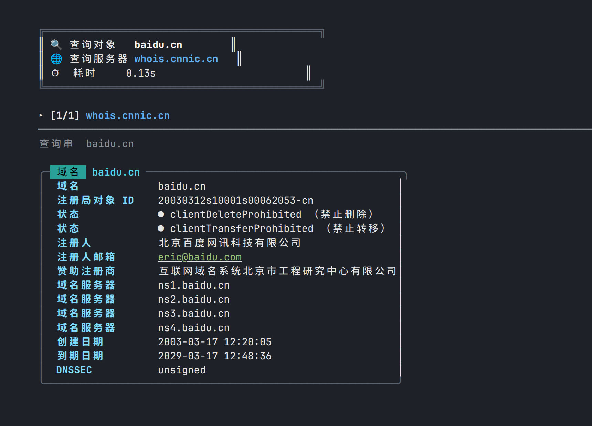
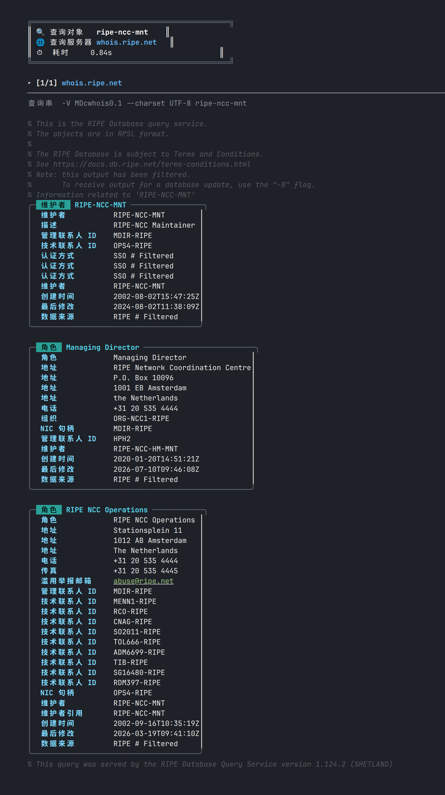

<h1 align="center">cwhois</h1>

<p align="center">
  A beautiful, colorful, Chinese-first <code>whois</code> client —<br>
  <b>100% compatible with the classic <a href="https://github.com/rfc1036/whois">whois</a> CLI, down to the last byte of output.</b>
</p>

<p align="center">
  
  
  
  
  <a href="README.zh-CN.md"></a>
</p>

<p align="center">
  
</p>

## Features

- **🎨 Pretty by default** — when stdout is a TTY, whois records are rendered as rounded cards with 200+ Chinese field labels, colored status dots with Chinese annotations (e.g. `clientTransferProhibited （禁止转移）`), syntax highlighting for dates / emails / URLs / IPs / name servers, and 🔒 markers for GDPR-redacted data.
- **📜 Byte-for-byte compatible** — when piped (or with `--raw`), output is **identical to the classic `whois` client**, verified against whois 5.6.6 on 22 real-world scenarios (registry + registrar referral chains, IPs, ASNs, IPv6, 6to4/Teredo, in-addr.arpa, RIPE flags, IDN domains…).
- **🧬 Complete whois parity** — every command-line option of `whois` is supported, including all long RIPE flags (`--list-sources`, `--filter-tag-include`, …), the upstream quirks (yes, even `--exact` swallowing its argument), `WHOIS_OPTIONS`, `WHOIS_HIDE`, `WHOIS_SERVER`, and `/etc/whois.conf`.
- **🌐 IDN / punycode** — query `例え.jp` or `中国.cn` directly; conversion follows RFC 3492.
- **🔣 Charset recoding** — server responses in ISO-8859-1 / CP1251 / ISO-2022-JP are transparently converted to UTF-8.
- **⚡ Zero dependencies** — a single self-contained Rust binary, no crates, no network needed at build time.

## Install

**From source (Rust toolchain required):**

```sh
git clone https://github.com/TinggalLeaf/cwhois.git
cd cwhois
cargo install --path .        # installs ~/.cargo/bin/cwhois
# or: cargo build --release    # binary at target/release/cwhois
```

## Usage

`cwhois` accepts **every option the classic `whois` client does**. A query object is all you need — the right whois server is chosen automatically (registry → registrar referral chains are followed for you):

```console
$ cwhois baidu.cn            # TTY: colorful Chinese cards (screenshot above)
$ cwhois baidu.cn | cat      # piped: byte-identical to classic whois output
$ cwhois --raw baidu.cn      # force raw output
$ cwhois --pretty 8.8.8.8    # force pretty rendering
$ cwhois 例え.jp              # IDN domains work out of the box
```

<details>
<summary><b>All supported options</b> (click to expand — same as <code>whois --help</code>, in Chinese)</summary>

```
用法: cwhois [选项]... 对象...

  -h HOST, --host HOST   连接到服务器 HOST
  -p PORT, --port PORT   连接到端口 PORT
  -I                     查询 whois.iana.org 并跟踪其引荐
  -H                     隐藏法律免责声明
      --verbose          显示执行过程
      --no-recursion     禁用从注册局到注册商服务器的递归
      --help             显示本帮助并退出
      --version          输出版本信息并退出

以下标志受 whois.ripe.net 及若干 RIPE 风格服务器支持:
-l -L -m -M -c -x -b -B -G -d
  -i ATTR[,ATTR]...      按指定 ATTRibute 做反向查询
  -T TYPE[,TYPE]...      只查找指定 TYPE 的对象
  -K                     只返回主键及其值
  -r                     关闭联系信息的递归查询
  -R                     强制显示含有引荐的域名对象的本地副本
  -a                     同时搜索所有镜像数据库
  -s SOURCE[,SOURCE]...  搜索镜像自 SOURCE 的数据库
  -g SOURCE:FIRST-LAST   查找 SOURCE 中从序列号 FIRST 到 LAST 的更新
  -t TYPE                请求 TYPE 类型对象的模板
  -v TYPE                请求 TYPE 类型对象的详细模板
  -q [version|sources|types]  查询指定服务器信息

cwhois 扩展选项:
      --raw              输出与 whois 一致的原始文本
      --pretty           强制彩色美化输出（即使输出被重定向）
      --color=WHEN       颜色模式: auto(默认) / always / never
```

All long options of the classic client are also recognized (`--server`, `--sources`, `--template`, `--select-types`, `--list-versions`, `--diff-versions`, `--filter-tag-include`, …), including GNU-style abbreviation (`--verb` → `--verbose`) and `--opt=value` / `-p43` forms.

</details>

### Output modes

| Environment | Default output | Why |
|---|---|---|
| Terminal (TTY) | Pretty colored cards | humans deserve nice things |
| Pipe / file / `$(...)` | Raw, byte-identical to `whois` | scripts keep working unchanged |

`NO_COLOR` is honored; `--color=always|never` overrides everything.

## How it works

`cwhois` is a ground-up Rust implementation that faithfully ports the behavior of Marco d'Itri's `whois` client (server selection tables, query-string mangling like ARIN's `n +` / Verisign's `domain ` prefix / DENIC's `-T dn,ace`, referral state machines for ARIN/APNIC/IANA/Verisign, disclaimer hiding, 6to4/Teredo/reverse-DNS conversions, IDNA, charset recoding) together with its embedded data tables and `zh_CN` translations. The pretty renderer is a strict superset: every line the server sends is preserved exactly once — anything that does not parse as a key/value record is shown verbatim.

## Configuration

- `/etc/whois.conf` — per-pattern server overrides (ERE subset) if present
- `WHOIS_OPTIONS` — options prepended to every invocation
- `WHOIS_HIDE` — enable disclaimer hiding, same as `-H`
- `WHOIS_SERVER` — fallback server for network-name lookups

## Gallery

<p align="center">
  
</p>

## License

[GPL-2.0-or-later](LICENSE) — derived from the `whois` client by Marco d'Itri <md@linux.it>.
