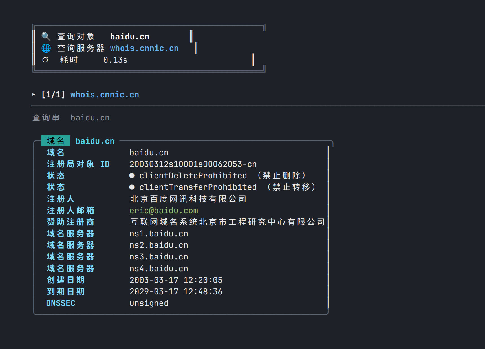
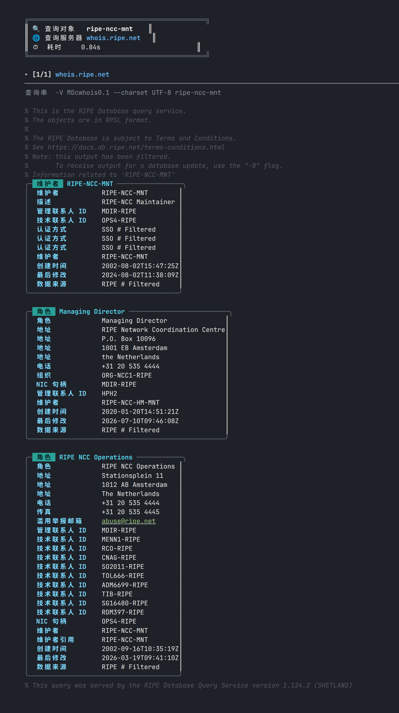

<h1 align="center">cwhois</h1>

<p align="center">
  好看又好用的中文 whois 命令行客户端 ——<br>
  <b>与经典 <a href="https://github.com/rfc1036/whois">whois</a> 命令完全兼容，原始输出逐字节一致。</b>
</p>

<p align="center">
  
  
  
  
  <a href="README.md"></a>
</p>

<p align="center">
  
</p>

## 特性

- **🎨 终端默认美化** —— 检测到 TTY 时，whois 记录渲染为圆角卡片：200+ 个中文字段标签（域名 / 注册商 / 到期日期……）、带中文注释的彩色状态圆点（如 `clientTransferProhibited （禁止转移）`）、日期 / 邮箱 / URL / IP / 域名服务器语法高亮、GDPR 遮蔽数据 🔒 标记。
- **📜 逐字节兼容** —— 管道输出（或 `--raw`）与经典 `whois` 客户端**完全一致**，已针对 whois 5.6.6 在 22 个真实场景（注册局→注册商引荐链、IP、ASN、IPv6、6to4/Teredo、in-addr.arpa、RIPE 全套标志、IDN 域名等）下回归验证。
- **🧬 完整参数兼容** —— 支持 `whois` 的全部命令行参数（含 `--list-sources`、`--filter-tag-include` 等全部 RIPE 长标志，甚至包括上游 `--exact` 会吞参数的怪癖），以及 `WHOIS_OPTIONS`、`WHOIS_HIDE`、`WHOIS_SERVER` 环境变量与 `/etc/whois.conf`。
- **🌐 IDN / punycode** —— 直接查询 `例え.jp`、`中国.cn`，RFC 3492 转换。
- **🔣 字符集转码** —— ISO-8859-1 / CP1251 / ISO-2022-JP 响应自动转 UTF-8。
- **⚡ 零依赖** —— 单个 Rust 二进制，无 crates.io 依赖，离线可构建。

## 安装

**源码构建（需要 Rust 工具链）：**

```sh
git clone https://github.com/TinggalLeaf/cwhois.git
cd cwhois
cargo install --path .        # 安装到 ~/.cargo/bin/cwhois
# 或: cargo build --release    # 二进制位于 target/release/cwhois
```

## 使用

`cwhois` 接受经典 `whois` 客户端的**全部选项**。只需给出查询对象，合适的 whois 服务器会自动选择（注册局→注册商引荐链自动跟踪）：

```console
$ cwhois baidu.cn            # TTY 下：中文彩色卡片（见顶部截图）
$ cwhois baidu.cn | cat      # 管道下：与经典 whois 输出逐字节一致
$ cwhois --raw baidu.cn      # 强制原始输出
$ cwhois --pretty 8.8.8.8    # 强制美化渲染
$ cwhois 例え.jp              # IDN 域名直接查询
```

<details>
<summary><b>全部支持的选项</b>（点击展开，与 <code>whois --help</code> 一致）</summary>

```
用法: cwhois [选项]... 对象...

  -h HOST, --host HOST   连接到服务器 HOST
  -p PORT, --port PORT   连接到端口 PORT
  -I                     查询 whois.iana.org 并跟踪其引荐
  -H                     隐藏法律免责声明
      --verbose          显示执行过程
      --no-recursion     禁用从注册局到注册商服务器的递归
      --help             显示本帮助并退出
      --version          输出版本信息并退出

以下标志受 whois.ripe.net 及若干 RIPE 风格服务器支持:
-l -L -m -M -c -x -b -B -G -d
  -i ATTR[,ATTR]...      按指定 ATTRibute 做反向查询
  -T TYPE[,TYPE]...      只查找指定 TYPE 的对象
  -K                     只返回主键及其值
  -r                     关闭联系信息的递归查询
  -R                     强制显示含有引荐的域名对象的本地副本
  -a                     同时搜索所有镜像数据库
  -s SOURCE[,SOURCE]...  搜索镜像自 SOURCE 的数据库
  -g SOURCE:FIRST-LAST   查找 SOURCE 中从序列号 FIRST 到 LAST 的更新
  -t TYPE                请求 TYPE 类型对象的模板
  -v TYPE                请求 TYPE 类型对象的详细模板
  -q [version|sources|types]  查询指定服务器信息

cwhois 扩展选项:
      --raw              输出与 whois 一致的原始文本
      --pretty           强制彩色美化输出（即使输出被重定向）
      --color=WHEN       颜色模式: auto(默认) / always / never
```

经典客户端的全部长选项均可识别（`--server`、`--sources`、`--template`、`--select-types`、`--list-versions`、`--diff-versions`、`--filter-tag-include` 等），并支持 GNU 风格缩写（`--verb` → `--verbose`）以及 `--opt=value`、`-p43` 形式。

</details>

### 输出模式

| 环境 | 默认输出 | 原因 |
|---|---|---|
| 终端（TTY） | 彩色美化卡片 | 人值得用好看的东西 |
| 管道 / 文件 / `$(...)` | 原始输出，与 `whois` 逐字节一致 | 脚本零改动兼容 |

尊重 `NO_COLOR` 环境变量；`--color=always|never` 可覆盖一切。

## 实现原理

`cwhois` 是用 Rust 从头实现的客户端，忠实移植了 Marco d'Itri 的 `whois` 客户端行为：服务器选择数据表、查询串变形（ARIN 的 `n +`、Verisign 的 `domain ` 前缀、DENIC 的 `-T dn,ace` 等）、ARIN/APNIC/IANA/Verisign 引荐状态机、免责声明隐藏、6to4/Teredo/反向 DNS 转换、IDNA、字符集转码，并内嵌其全部数据表与 `zh_CN` 官方翻译。美化渲染是严格超集：服务器返回的每一行都原样保留至少一次——任何无法解析为键值对的内容都会逐字显示。

## 配置

- `/etc/whois.conf` —— 若存在，按模式覆盖服务器（ERE 子集）
- `WHOIS_OPTIONS` —— 每次调用前自动附加的选项
- `WHOIS_HIDE` —— 存在即启用免责声明隐藏，等同 `-H`
- `WHOIS_SERVER` —— 网络名查询的兜底服务器

## 效果图

<p align="center">
  
</p>

## 许可证

[GPL-2.0-or-later](LICENSE) —— 衍生自 Marco d'Itri <md@linux.it> 的 `whois` 客户端。
